# Intelligent Face Tracker

An AI-powered real-time visitor tracking and unique visitor counting system using face detection, multi-object tracking, face recognition, automatic visitor registration, and event logging.

## 1. Project Overview

The Intelligent Face Tracker is designed to detect, track, recognize, and count unique visitors from a video or camera stream.

The system identifies whether a detected face belongs to an already registered visitor. If the face is not recognized after multiple consistent observations, the system automatically registers it as a new visitor with a unique visitor ID.

The system also records visitor entry and exit events with timestamps and stores face images and event metadata for later verification.

## 2. Problem Statement

Traditional visitor counting systems may count the same person multiple times when the person appears in different frames or temporarily leaves and reappears.

This project addresses that problem by combining:

- AI-based face detection
- Multi-object tracking
- Face embeddings
- Similarity-based face recognition
- Automatic visitor registration
- Persistent visitor identities
- Entry and exit event logging
- SQLite database storage

The objective is to maintain a reliable unique visitor count instead of simply counting detected faces in individual frames.

## 3. System Architecture

The diagram shows the two connected paths: video ingestion and recognition,
and dashboard control and display. Optional detections are marked explicitly.

```mermaid
flowchart LR
    subgraph Sources["Video sources"]
        BrowserCamera["Browser camera"]
        DeviceSource["Local camera, video file, or network stream"]
        Upload["Video upload"]
    end

    subgraph Dashboard["Dashboard service (Flask)"]
        UI["Dashboard UI"]
        ControlAPI["Source, camera-frame, and upload APIs"]
        ReadAPI["Status, statistics, visitor, event, and sighting APIs"]
        MJPEG["Annotated MJPEG stream"]
        UI --> ControlAPI
        UI --> ReadAPI
        ReadAPI --> UI
        MJPEG --> UI
    end

    BrowserCamera -->|JPEG frames| ControlAPI
    Upload --> ControlAPI
    ControlAPI -->|save uploaded video| UploadStore["videos/uploads"]
    ControlAPI -->|queued source changes / browser camera frames| Loop

    DeviceSource --> Capture["OpenCV video capture"]
    UploadStore --> Capture

    subgraph Tracker["Tracking process (src/main.py)"]
        Loop["Frame processing loop"]
        FaceDetect["YOLOv8 face detection + ByteTrack"]
        Validation{"YuNet validation enabled?"}
        YuNet["YuNet cross-validation"]
        PersonDetect["Optional OpenCV HOG person detection"]
        Recognize["Recognition worker pool"]
        Embed["InsightFace / ArcFace face embedding"]
        Manager["VisitorManager: match or confirm new identity"]
        Lifecycle["Track lifecycle and entry / exit handling"]
        Count["Distinct visitor IDs (unique count)"]

        Loop --> FaceDetect
        FaceDetect --> Validation
        Validation -->|yes| YuNet
        YuNet -->|confirmed candidates| Recognize
        Validation -->|no| Recognize
        Loop -. "when enabled" .-> PersonDetect
        Recognize --> Embed
        Embed --> Manager
        Manager --> Lifecycle
        Lifecycle --> Count
    end

    Capture --> Loop
    ControlAPI -->|browser camera frames| Loop

    subgraph Storage["Persistent files"]
        DB[("SQLite: visitors, embedding templates, events, sightings")]
        EventLog["logs/events.log"]
        Images["Face evidence under logs/"]
    end

    Manager <--> DB
    Lifecycle -->|ENTRY / EXIT records| DB
    Loop -->|unrecognized sightings| DB
    Lifecycle -->|application events| EventLog
    Lifecycle -. "if image saving is enabled" .-> Images
    Loop -. "unrecognized-sighting images, when enabled" .-> Images
    Loop -->|annotated frames| MJPEG
    Count --> MJPEG
    DB --> ReadAPI

    PersonDetect -. "no-face detections; not identity matches" .-> Lifecycle
```

### Architecture walkthrough

1. **Input and source control:** `src/main.py` reads the configured source and
   uses OpenCV for attached cameras, video files, and supported network streams.
   The Flask dashboard can queue a source change or save an uploaded video under
   `videos/uploads`. For a browser camera, the dashboard sends JPEG frames to
   Flask, which passes them to the processing loop.
2. **Detection and tracking:** The processing loop runs YOLOv8 face detection
   with ByteTrack to associate detections with track IDs. YuNet face
   cross-validation is optional. The optional OpenCV HOG detector reports
   person boxes without a visible face; it does not recognize those people or
   associate them with a visitor identity.
3. **Recognition and registration:** Stable face tracks are submitted to a
   small worker pool. InsightFace produces an ArcFace embedding, and
   `VisitorManager` compares it with the stored visitor embedding templates.
   A match reuses the existing visitor ID. An unmatched face remains pending
   until consistent observations confirm it, then a new visitor and embedding
   are stored in SQLite.
4. **Events and evidence:** Recognized tracks produce one `ENTRY` event per
   active track and an `EXIT` event when the track expires. Visitor records,
   embedding templates, and entry/exit events are persisted in
   `database/visitors.db`. Operational messages, including tracking activity,
   are written to `logs/events.log`; tracking messages are not separate
   database event records. Face images are saved under `logs/` when image
   saving is enabled. Unrecognized face and no-face person sightings are
   recorded separately from visitor identities.
5. **Dashboard output:** The Flask service serves the browser UI, source
   controls, and JSON APIs that read status and persisted data. The processing
   loop sends annotated frames to the dashboard's MJPEG stream. The dashboard
   runs alongside the tracker in a server thread; it is not a separate
   recognition or tracking process.

## 4. Technology Stack

### Programming Language

- Python 3.10

### Computer Vision

- OpenCV
- YOLO
- ByteTrack

### Face Recognition

- InsightFace
- ArcFace face embeddings

### Database

- SQLite

### Configuration

- JSON

### Logging

- Python logging
- Local event log

## 5. Main Features

### Face Detection

YOLO is used to detect faces from the input video stream.

### Multi-Object Tracking

ByteTrack provides stable track IDs for detected faces across video frames.

### Face Recognition

InsightFace generates a 512-dimensional face embedding for detected faces.

The embedding is compared with stored visitor embeddings using cosine similarity.

### Automatic Visitor Registration

When a face does not match an existing visitor, the system does not immediately create a new visitor.

The face is first kept as a pending track and multiple consistent observations are required.

After successful confirmation, a new visitor ID is created automatically.

### Unique Visitor Counting

Each registered visitor receives a persistent visitor ID.

If the same person leaves and later appears again, their face embedding is compared with stored visitor embeddings and the existing visitor ID is reused.

Therefore, the same person is not counted as a new visitor.

### Entry and Exit Events

The system records:

- Visitor ID
- Track ID
- Event type
- Timestamp
- Face image path

Supported events include:

- ENTRY
- TRACKING
- EXIT

### Persistent Storage

Visitor information, embeddings, and event metadata are stored in SQLite.

### Event Logging

Important system operations are recorded in:

    logs/events.log

The log includes events such as:

- Recognition started
- Embedding generated
- Face recognized
- New face pending
- Visitor registered
- Embedding template added
- Tracking
- Track exit
- Visitor exit

## 6. Project Structure

    intelligent-face-tracker/
    |
    +-- database/
    |   +-- visitors.db
    |
    +-- docs/
    |
    +-- logs/
    |   +-- events.log
    |   +-- entries/
    |   +-- exits/
    |
    +-- models/
    |   +-- face_detection_yunet_2023mar.onnx
    |   +-- yolov8n-face.pt
    |
    +-- output/
    |
    +-- src/
    |   +-- main.py
    |   +-- face_detector.py
    |   +-- face_tracker.py
    |   +-- face_recognizer.py
    |   +-- visitor_manager.py
    |   +-- database.py
    |   +-- logger.py
    |   +-- image_logger.py
    |   +-- ...
    |
    +-- tests/
    |
    +-- videos/
    |
    +-- app.py
    +-- config.json
    +-- requirements.txt
    +-- README.md
    +-- .gitignore

## 7. Configuration

The system uses config.json for runtime configuration.

Example configuration:

    {
        "input": {
            "source": "browser",
            "type": "browser"
        },
        "detection": {
            "confidence": 0.25,
            "skip_frames": 1,
            "image_size": 800,
            "min_face_size": 20,
            "validate_with_yunet": false
        },
        "person_detection": {
            "enabled": true,
            "max_dimension": 640,
            "score_threshold": 1.1,
            "min_hits": 2,
            "max_missing": 1
        },
        "recognition": {
            "similarity_threshold": 0.62
        },
        "tracking": {
            "max_missing_frames": 30
        },
        "output": {
            "show_window": false,
            "save_images": true
        }
    }

### Input Source

    "source": "browser"

uses the camera opened by the dashboard browser. A numeric source such as
`"0"` opens the tracker's default attached camera.

The default source, `browser`, waits for you to click **Start device camera** in
the dashboard and grant browser permission. This uses the camera on the device
that opened the dashboard, including a phone camera when the dashboard is
opened on that phone. Open the dashboard at `http://127.0.0.1:5000` on the
tracker computer for local camera access. Browsers block camera access on
ordinary HTTP network addresses; a phone connecting to another computer needs
the dashboard served over trusted HTTPS.

Use a numeric source such as `"0"` for a camera attached to the tracker
computer. An uploaded video or RTSP stream can be selected in the dashboard.

### Detection

    "confidence": 0.5

controls the detection confidence threshold.

    "skip_frames": 5

controls how many input frames are skipped between detection/tracking passes. Higher values can speed up processing at the cost of tracking detail. The shipped profile uses 1 (process every second frame), confidence 0.25, 800-pixel inference, and a 20-pixel minimum face size. On the included sample, the 800-pixel profile averaged about 0.055 seconds per tracked inference and retained three ByteTrack IDs across the first 45 frames; a 960-pixel run at confidence 0.30 averaged about 0.070 seconds. These are CPU measurements on one sample, not a performance guarantee. Detection and recognition quality still depend on lighting, face size, motion, and the available CPU/GPU. YuNet cross-validation is optional and disabled by default because it costs CPU time and can reject true YOLO detections.

The optional CPU HOG pedestrian detector (`person_detection.enabled`) adds boxes
labelled **Person detected - no face visible** when it finds a body without a face.
This is detection only: it does not identify a person or connect a back-facing
body track to that person's face identity. It filters weak HOG scores and
requires repeated overlapping detections, which reduces one-frame false
positive boxes. Each unrecognized face or person detected without a visible
face is recorded permanently in a separate sightings list with its first-seen
time and, when available, a saved image. These records survive source changes
and app restarts; **Reset database** clears them. They are not visitor records
and do not create entry/exit events. Face recognition requires a visible,
sufficiently large face.

Use `validate_with_yunet: true` to enable the second detector when precision is more important than speed. Raise the confidence/minimum face size to reduce small or uncertain detections; lowering either can increase false detections.

### Recognition

    "similarity_threshold": 0.62

controls the minimum similarity required to recognize a stored visitor. The default was raised to reduce false matches; identities with poor lighting, side angles, or very small faces may need another clear observation before they match.

Unregistered faces are enrolled only after two consistent same-track embeddings
agree (default pending similarity 0.60), which reduces duplicate visitor
records without relying on a single blurry frame.

### Tracking

    "max_missing_frames": 30

controls how long a missing track can remain active.

## 8. Installation

### Step 1: Clone the repository

    git clone <YOUR_GITHUB_REPOSITORY_URL>
    cd intelligent-face-tracker

### Step 2: Create a virtual environment

    python -m venv .venv

### Step 3: Activate the environment

Windows PowerShell:

    .venv\Scripts\Activate.ps1

### Step 4: Install dependencies

    pip install -r requirements.txt

On Windows, `setup_local.bat` creates the Python 3.10 virtual environment and
installs the pinned dependencies. Initial setup requires internet access to
download packages. Once setup completes, use `start_local.bat` for future
launches; it runs the tracker with the project's environment and keeps the
console open if the application exits with an error.

The first start may also need to download InsightFace's `buffalo_l` model
weights if they are not already present in the local model cache. After the
weights are cached, inference runs locally. Keep the `models` directory,
`config.json`, and local `database`, `logs`, and `videos` data together when
moving or backing up an installation.

## 9. Running the System

From the project root:

    python src\main.py

The configured input source is loaded from:

    config.json

Startup validates configuration values and reports the offending setting
before loading the tracking pipeline. Detection thresholds, frame skipping,
image dimensions, tracking limits, and output flags must use supported types
and ranges.

The application opens the configured camera, local video, or network stream and serves the dashboard at:

    http://127.0.0.1:5000

By default, the dashboard binds to loopback only. To make it reachable from
another device, set `DASHBOARD_HOST=0.0.0.0`; set `DASHBOARD_PORT` to change the
port. To enable HTTPS directly, provide both `DASHBOARD_TLS_CERT` and
`DASHBOARD_TLS_KEY` with paths to a browser-trusted certificate and key. For
example, in PowerShell:

    $env:DASHBOARD_HOST = "0.0.0.0"
    $env:DASHBOARD_TLS_CERT = "C:\certs\tracker.crt"
    $env:DASHBOARD_TLS_KEY = "C:\certs\tracker.key"
    python src\main.py

Open the resulting HTTPS address on the client device and allow camera access.
For a phone, the certificate must be trusted by the phone; a self-signed
certificate warning does not satisfy browser camera security requirements.
The dashboard has no authentication, so expose it only on a trusted network
and use a firewall or an authenticated HTTPS reverse proxy when remote access
is needed.

The dashboard can switch sources while the application is running:

- Start the laptop/mobile camera directly in the browser. Frames are sent to the tracker for inference; use `https://` when the dashboard is opened from another device (browser camera permissions are blocked on ordinary LAN HTTP).
- Upload a supported video (AVI, MKV, MOV, MP4, MPEG, MPG, or WEBM; maximum 512 MB). The video is processed from the server's local `videos\uploads` folder. Processing stops at end-of-file and waits for another source.
- Connect a camera attached to the tracker computer using its camera index (for example, `0`).
- Connect an RTSP, RTMP, HTTP, or HTTPS stream using a stream URL. The application retries a dropped live connection.
- RTSP streams try TCP transport first and fall back to UDP if opening fails. If neither can connect, check network access to the camera's RTSP port, the stream path, and any required credentials.
- At end-of-file and when switching sources, recognized visitors receive exit events and outstanding face-recognition work is given up to 10 seconds to finish.

First-time visitor registration is confirmed from two consistent face
embeddings. If an embedding cannot be extracted, the tracker now retries with
a short backoff instead of permanently abandoning the face after four failed
attempts.

Source paths in `config.json` are resolved relative to the project root, so the program can also be launched from another working directory. The visitor directory shows the latest saved entry/exit face image for each visitor when one exists; if image saving is disabled or no event image is available, it shows the visitor ID placeholder instead.

For a headless run, set `output.show_window` to `false` in `config.json`; the dashboard feed remains available.

The tracker uses CUDA for InsightFace when `onnxruntime` reports a CUDA provider and otherwise selects CPU. The checked workspace currently reports CPU/Azure providers only and PyTorch is CPU-only, so inference runs on CPU and cannot match a CUDA-equipped live system's throughput. GPU deployments need CUDA-compatible PyTorch and `onnxruntime-gpu` builds in place of CPU-only packages. `output.show_window` defaults to false to avoid rendering an extra desktop preview; use the dashboard for video, or set it true to enable the OpenCV window.

Use the dashboard's **Reset database** action to clear visitor identities and embeddings, entry/exit counts and history, and saved face evidence. The browser asks for confirmation first; the live pipeline then clears its in-memory identities so visitors are recognized afresh.

To smoke-test YuNet independently from the full tracker:

    python src\camera_test.py 0
    python src\camera_test.py videos\sample.mp4
    python src\camera_test.py rtsp://camera-host/live --headless

## 10. Database

The system uses SQLite:

    database/visitors.db

### Visitors

The visitor database stores:

- Visitor ID
- First seen timestamp
- Last seen timestamp
- Face embedding

### Visitor Embeddings

Multiple embedding templates can be associated with a visitor to improve recognition across different observations.

### Events

Events store:

- Visitor ID
- Event type
- Timestamp
- Image path

## 11. Event Logging

Runtime events are written to:

    logs/events.log

The event log rotates at 5 MB and retains up to five previous log files so a
long-running local installation does not grow the log indefinitely.

Example:

    2026-10-01 20:48:44 | INFO | FACE_RECOGNIZED | track_id=1 | visitor_id=1 | similarity=0.849
    2026-10-01 20:48:44 | INFO | VISITOR_RECOGNIZED | visitor_id=1 | track_id=1
    2026-10-01 20:49:10 | INFO | TRACK_EXIT | track_id=1 | visitor_id=1
    2026-10-01 20:49:10 | INFO | EXIT | visitor_id=1 | track_id=1

## 12. Image Logging

Face images associated with events are stored locally.

Example structure:

    logs/
    +-- entries/
    |   +-- YYYY-MM-DD/
    |
    +-- exits/
        +-- YYYY-MM-DD/

Images are timestamped to make individual events traceable.

## 13. Recognition Flow

The recognition process follows these steps:

1. YOLO detects a face.
2. ByteTrack assigns a tracking ID.
3. InsightFace generates a face embedding.
4. The embedding is compared with stored visitor embeddings.
5. If a match is found, the existing visitor ID is reused.
6. If no match is found, the track enters a pending state.
7. Multiple consistent observations are required.
8. After confirmation, a new visitor is registered.
9. The visitor ID remains associated with the active track.
10. When the track exits, an EXIT event is recorded.

## 14. Unique Visitor Counting

The unique visitor count is based on persistent visitor IDs rather than the number of detected frames.

Example:

    Person A enters
        |
        v
    Visitor ID = 1
        |
        v
    Person A leaves
        |
        v
    EXIT recorded
        |
        v
    Person A enters again
        |
        v
    Face recognized as Visitor ID = 1
        |
        v
    Unique visitor count = 1

The same person therefore does not create a duplicate visitor record when returning.

## 15. Logging and Traceability

The system maintains traceability between:

    Track ID
        |
        v
    Visitor ID
        |
        v
    Database Record
        |
        v
    Event
        |
        v
    Timestamp
        |
        v
    Face Image

This allows recognition and entry/exit events to be inspected after processing.

## 16. Current Implementation

The implemented pipeline includes:

- YOLO face detection
- ByteTrack tracking
- InsightFace face embeddings
- Cosine similarity based recognition
- Pending-face confirmation
- Automatic visitor registration
- Persistent visitor embeddings
- SQLite storage
- Entry and exit event handling
- Timestamped face image storage
- Runtime event logging
- Unique visitor counting
- Configurable runtime parameters

## 17. Testing

The system has been tested with:

- Single-person detection
- Repeated recognition of the same person
- Multiple-person tracking
- Visitor exit detection
- Re-entry recognition
- Persistent visitor ID reuse
- Database event storage
- Embedding storage
- Entry/exit image logging

## 18. Future Improvements

Possible extensions include:

- Authenticated remote dashboard access
- Multiple camera support
- GPU acceleration
- Advanced track management
- Centralized PostgreSQL deployment
- Role-based access control
- Remote event monitoring
- Deployment using Docker

## 19. Hackathon

This project is developed as part of the visitor tracking and unique visitor counting challenge.

This project is a part of a hackathon run by https://katomaran.com
